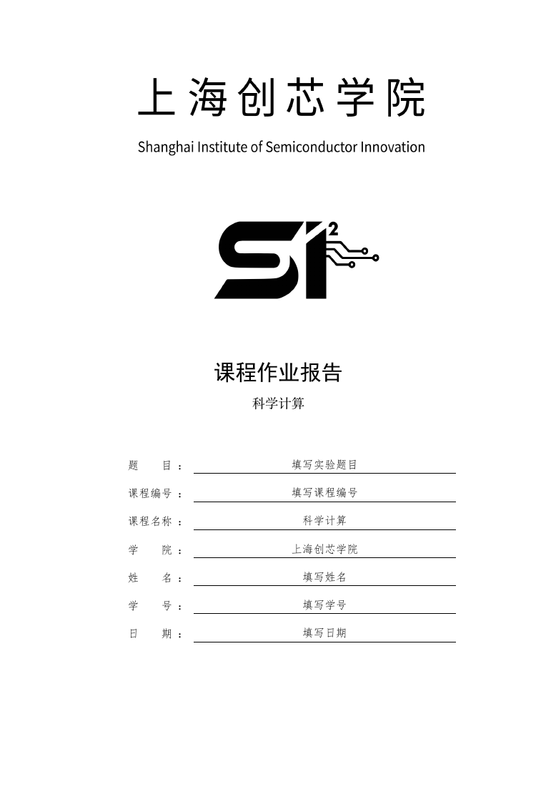

# 上海创芯学院课程报告模板

基于 [Keldos-Li/typora-latex-theme](https://github.com/Keldos-Li/typora-latex-theme) 的社区适配。沿用 LaTeX 风格的中文正文、数学公式、自动编号与三线表；替换封面的浙江大学标识，默认采用“科学计算”课程名称，不设置摘要和关键词。

## 快速使用

1. 按 [上游安装教程](../../src/README.md) 安装与操作系统对应的 `Latex` 主题和推荐字体。本目录不需要安装额外主题或执行脚本。
2. 将本目录完整复制到你的工作目录，保留 `assets/` 与 Markdown 文件的相对位置。
3. 用 Typora 打开 [report-template.md](./report-template.md)，选择 `Latex` 主题。
4. 把封面和正文中的“填写…”文字替换为自己的信息。只有封面时使用 [cover-template.md](./cover-template.md)。
5. 导出 PDF 时使用 A4，沿用主题的打印页边距：上 1.8 cm、左右 2 cm、下 1.2 cm。检查标识、分页、公式和表格后再提交。

[查看两页样例 PDF](./report-template.pdf)

## 文件说明

| 文件 | 用途 |
| --- | --- |
| `cover-template.md` | 可独立复用的学院封面；样式写在 HTML 属性中，与上游主题兼容 |
| `report-template.md` | 封面及正文骨架，含公式和表格示例 |
| `report-template.pdf` | 使用上游 CSS 渲染的占位内容预览 |
| `preview.png` | 通用封面预览，不含真实个人资料 |
| `assets/sisi-official.svg` | 官网原始矢量标识 |
| `assets/sisi-name.svg` | 从同一矢量文件显示校名部分 |
| `assets/sisi-symbol.svg` | 从同一矢量文件显示图形部分 |
| `assets/SOURCES.md` | 标识来源、处理方式与权利说明 |

## 个性化调整

- 课程、题目、姓名、学号、日期均可直接修改封面 HTML 中的文字；请同时修改正文署名。
- 封面高度 `263mm` 针对 A4 及上述页边距设置。更改页边距时请相应调整高度，避免封面跨页。
- 图形标识默认宽 `62mm`，`translateX(6.9mm)` 用于视觉居中。若标识宽度改为 `W`，可先按 `6.9 × W / 62` mm 等比例调整，再检查预览。
- 需要彩色显示时删除 `filter:brightness(0)`，但官网原图为白色，必须提供足够对比度的背景。
- 模板不捆绑或安装字体。Windows 可使用上游推荐字体，其他平台将封面的黑体、仿宋、楷体名称替换为本机可用的对应字体。

样例 PDF 通过上游 `latex.css`、推荐字体和本地数学渲染器生成；不同 Typora 版本及字体环境可能造成行距或换行差异。模板保留上游许可证，标识权利说明见 [assets/SOURCES.md](./assets/SOURCES.md)。
